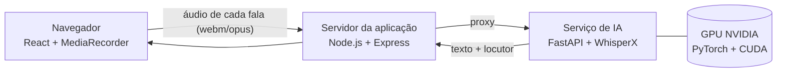

# 🩺 Fala Saúde

### Inteligência artificial para apoio à organização e documentação clínica

O **Fala Saúde** é uma solução baseada em Inteligência Artificial criada para auxiliar profissionais da área da saúde na organização das informações durante o atendimento.

A proposta é reduzir o tempo gasto com tarefas administrativas e documentação, permitindo que o profissional tenha mais facilidade para consultar o histórico do paciente e registrar as informações da consulta.

## 💡 Como funciona?

Durante o atendimento, o profissional pode, mediante autorização do paciente, utilizar o sistema de voz para registrar a conversa.

A IA então:

* 🎙️ Realiza a transcrição da conversa;
* 📋 Organiza as informações relevantes do atendimento;
* 🧠 Consulta o histórico do paciente;
* 🔎 Identifica possíveis divergências ou informações que merecem conferência;
* 📝 Auxilia na elaboração de documentos e solicitações mencionados durante a consulta;
* 📌 Mantém as informações organizadas para consultas futuras.

### Exemplo

Durante uma consulta, o paciente informa que possui alergia a amendoim.

O sistema pode identificar essa informação e compará-la com registros anteriores do paciente, sinalizando ao profissional caso exista alguma informação diferente que precise ser conferida.

Da mesma forma, caso o profissional mencione durante a consulta a necessidade de um exame, o sistema pode preparar um rascunho da solicitação para posterior conferência.

## ⚕️ A IA não substitui o profissional

O Fala Saúde foi pensado como uma ferramenta de **apoio**, e não como substituição da decisão profissional.

Todas as informações, sugestões e documentos gerados pela IA devem ser **revisados e validados pelo profissional responsável antes de serem utilizados**.

Caso o sistema identifique ou gere uma informação que não possa ser confirmada com segurança, ela deve ser sinalizada para revisão em vez de ser automaticamente incorporada ao histórico do paciente.

## 🎯 Objetivo

Reduzir o tempo gasto com documentação e organização de informações, ajudando o profissional a se concentrar mais no atendimento ao paciente.

## 🎨 Protótipo
https://www.figma.com/design/SPFoFzuS2wpFew8xFyM7jD/Sem-t%C3%ADtulo?node-id=0-1&t=p5wWENsxcmrC3YWE-1

> O protótipo será disponibilizado conforme o desenvolvimento da solução.

## 🚀 Tecnologias

As tecnologias utilizadas no projeto serão adicionadas conforme o desenvolvimento do protótipo e da aplicação.

## 👥 Equipe

Projeto desenvolvido durante o Hackathon IA na Saúde.

* Integrantes:
* Aleksandra Santos Berto
* Yan de Sousa Ferrezin
* Marcio Rodolfo Marcondes Martinson
---

# Tecnologias do FalaPsi

O FalaPsi é um assistente de documentação clínica para psiquiatria ambulatorial. Ele escuta a consulta, transcreve em tempo real, identifica quem está falando pela voz e prepara a evolução clínica, as receitas, os pedidos de exame e os atestados para o médico revisar e assinar.

**Toda a IA roda localmente**, no computador do consultório: o áudio da consulta não sai da clínica.

## Arquitetura

## Frontend

| Tecnologia | Versão | Uso |
|---|---|---|
| [React](https://react.dev) | 19.3 | Interface das telas (consulta, revisão, resumo, calibração de voz) |
| [TypeScript](https://www.typescriptlang.org) | 7.0 | Linguagem do frontend e do servidor |
| [Vite](https://vite.dev) | 8.3 | Build e servidor de desenvolvimento |
| [Tailwind CSS](https://tailwindcss.com) | 4.3 | Estilos e layout |
| MediaRecorder API | — | Gravação do microfone |
| Web Audio API | — | Detecção de voz e pausas e medidor de nível do microfone |
| Web Speech API | — | Transcrição reserva, quando o serviço de IA está desligado |
| CSS de impressão (`@media print`) | — | Atestados, receitas e guias em folha A4 |
| Material Symbols e Google Fonts | — | Ícones e tipografia (Inter, Plus Jakarta Sans) |

## Backend

| Tecnologia | Versão | Uso |
|---|---|---|
| [Node.js](https://nodejs.org) | 24 | Ambiente de execução do servidor |
| [Express](https://expressjs.com) | 4.22 | Servidor da aplicação e proxy para o serviço de IA |
| [tsx](https://github.com/privatenumber/tsx) | 4.23 | Execução direta do servidor em TypeScript |
| [Google Gen AI SDK](https://github.com/googleapis/js-genai) | 2.24 | Integração opcional com o Gemini (inativa sem chave de API) |

## Transcrição e identificação de voz (IA local)

| Tecnologia | Versão | Uso |
|---|---|---|
| [WhisperX](https://github.com/m-bain/whisperX) | 3.8.6 | Transcrição com marcação de tempo por palavra |
| Whisper large-v3-turbo | — | Modelo de reconhecimento de fala em português |
| [faster-whisper](https://github.com/SYSTRAN/faster-whisper) / [CTranslate2](https://github.com/OpenNMT/CTranslate2) | 1.2.1 / 4.8.2 | Execução otimizada do Whisper (int8/float16) |
| wav2vec2 (português) | — | Alinhamento das palavras no tempo |
| [pyannote.audio](https://github.com/pyannote/pyannote-audio) | 4.0.7 | Extração da impressão de voz |
| [WeSpeaker ResNet34](https://huggingface.co/pyannote/wespeaker-voxceleb-resnet34-LM) | — | Modelo de impressão de voz: reconhece o médico e separa as demais vozes |
| [PyTorch](https://pytorch.org) + CUDA 12.8 | 2.8.0 | Execução dos modelos na GPU NVIDIA |
| [Hugging Face Transformers](https://github.com/huggingface/transformers) | 4.57 | Download e carregamento dos modelos |
| [FastAPI](https://fastapi.tiangolo.com) + [Uvicorn](https://www.uvicorn.org) | 0.141 / 0.53 | API do serviço de IA |
| Python | 3.11 | Linguagem do serviço de IA |
| [FFmpeg](https://ffmpeg.org) | 8.x | Conversão do áudio gravado para processamento |

## Inteligência clínica (desenvolvida no projeto)

| Componente | O que faz |
|---|---|
| Extrator de decisões clínicas | Regras em português para psiquiatria. Detecta prescrições (com dose e posologia), exames, encaminhamentos, retorno e atestados, a partir apenas de falas do médico com intenção de conduta |
| Classificação pela Portaria SVS/MS 344/98 | Separa receita simples, controle especial C1 (2 vias) e notificações B1/A3 (talonário oficial) |
| Diarização por voz | A voz calibrada do médico é identificada como médico; qualquer outra voz é tratada como paciente |
| Diarização por texto | Classifica médico ou paciente pelo conteúdo da fala, quando a voz não foi calibrada |

## Requisitos da máquina

Medidos em um notebook com Intel Core i5-11400H, NVIDIA RTX 3050 (4 GB) e 16 GB de RAM:

| Recurso | Mínimo | Observação |
|---|---|---|
| GPU | NVIDIA com 4 GB de VRAM | O serviço de IA usa cerca de 2,2 GB; 6 a 8 GB dão folga para outros programas |
| RAM | 16 GB | — |
| Disco | 15 GB livres | ~8 GB de bibliotecas Python e ~6 GB de modelos |
| Sistema | Windows 10/11 ou Linux | Internet necessária apenas na instalação, para baixar os modelos |

Nessa máquina, a transcrição roda cerca de 2× mais rápido que a fala.

## Privacidade e conformidade

- **Processamento local:** o áudio da consulta não é enviado para a nuvem. Da voz do médico, só uma impressão numérica é guardada, nunca o áudio.
- **CFM 2.314/2022:** a IA registra apenas condutas verbalizadas pelo médico, que revisa e assina tudo.
- **LGPD:** dados sensíveis de saúde permanecem no ambiente da clínica.
- **Sigilo do diagnóstico:** o CID só entra no atestado com autorização expressa do paciente.

**Fala Saúde — tecnologia para facilitar a rotina de quem cuida.**
